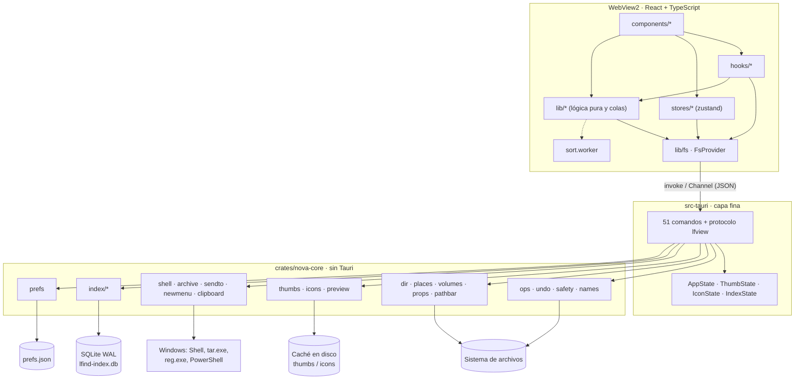
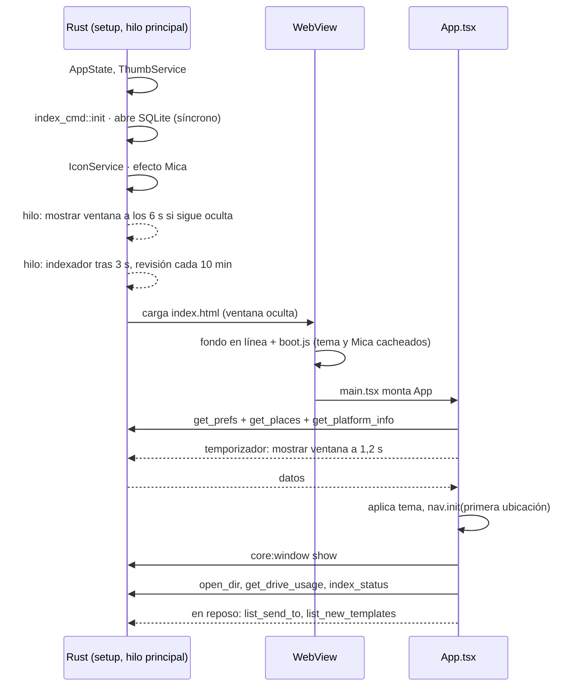
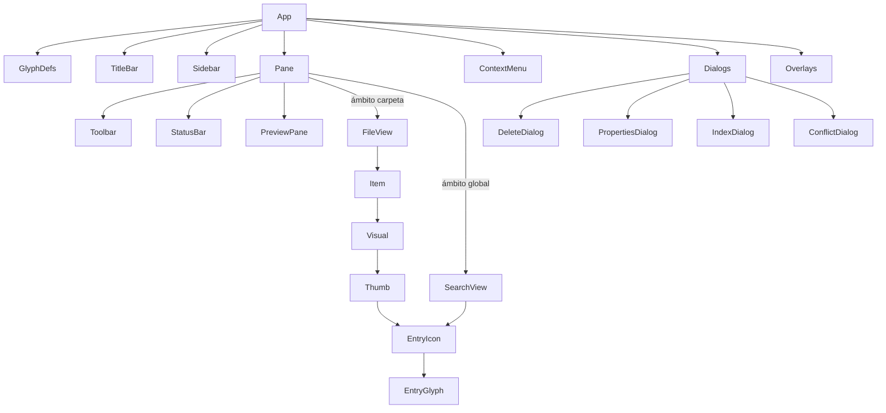
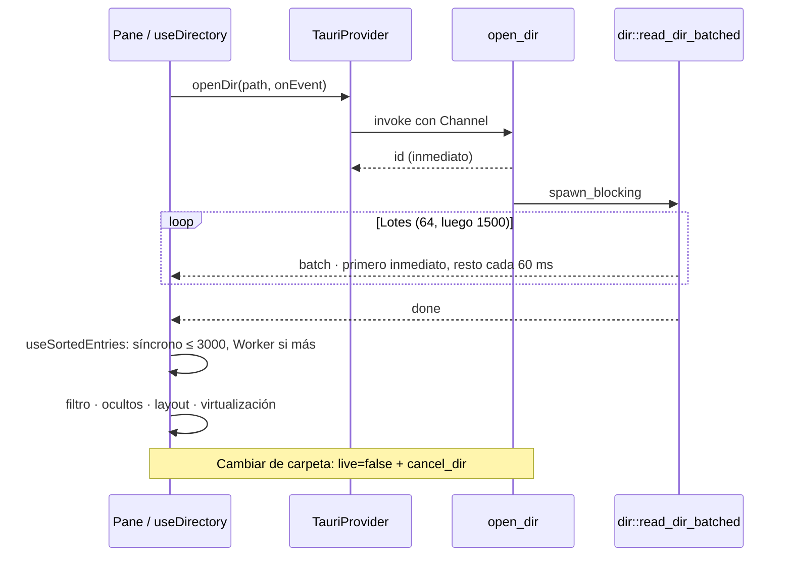
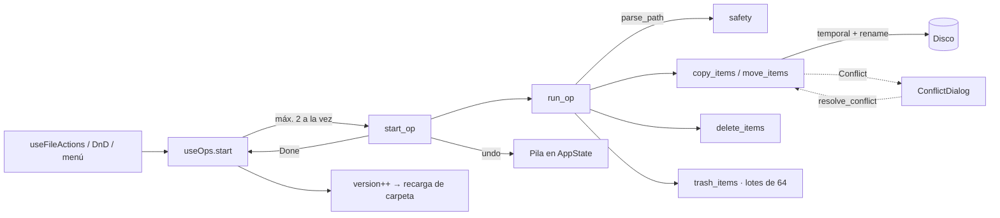
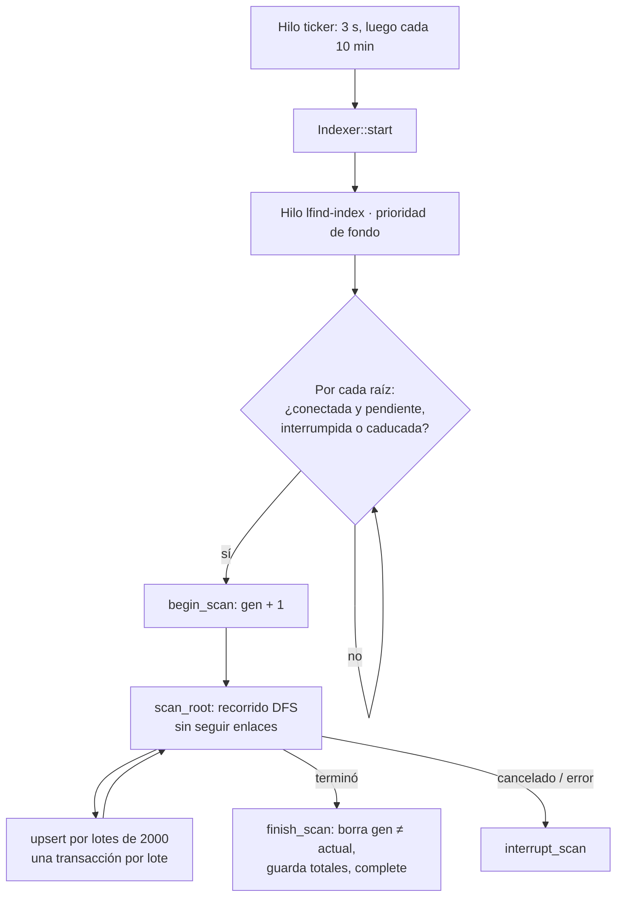
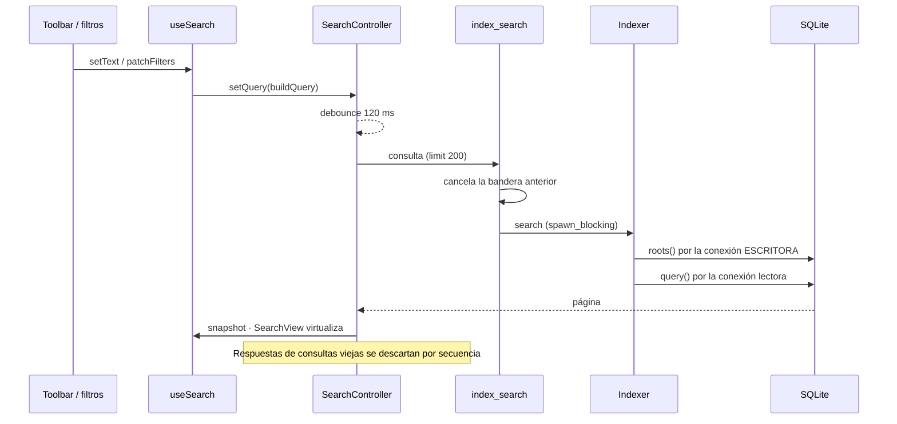
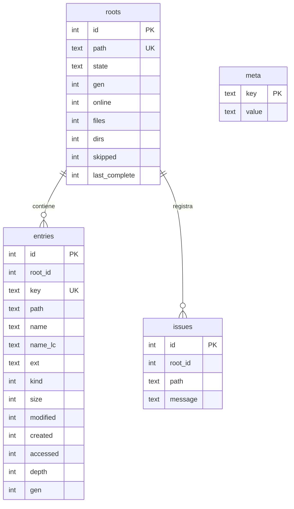
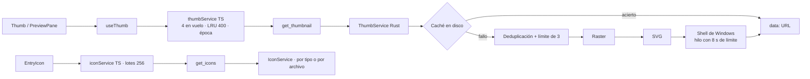
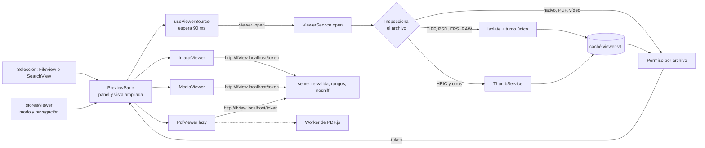

# LFind · PROJECT_ARCHITECTURE

Cómo se relacionan los módulos. Auditoría **Fase 0 — 2026-11-08**. Antes de cambiar algo, comprobar contra el código (regla 4 de [PROJECT_CONTEXT.md](PROJECT_CONTEXT.md)).

## 1. Vista general

## 2. Arranque

Puntos clave: `index_cmd::init` se ejecuta **dentro de `setup`** (ver R-08 en `PROJECT_STATUS.md`). Un fallo al abrir el índice no impide arrancar: la búsqueda queda desactivada con su mensaje.

## 3. Construcción de la interfaz

| Store | Responsabilidad |
|---|---|
| `nav` | Pestañas, historial atrás/adelante |
| `prefs` | Preferencias; guardado diferido 400 ms; `flush` al cerrar |
| `app` | Ubicaciones, unidades, Mica, uso de discos |
| `ui` | Toasts, menú abierto, diálogo actual |
| `ops` | Cola de operaciones, ocultación optimista, deshacer |
| `clipboard` | Portapapeles interno |
| `shellData` | «Enviar a» y plantillas, precargados en reposo |
| `search` | Ámbito, texto, filtros, resultados (delegado en `SearchController`) |
| `indexStatus` | Sondeo de estado: 1,5 s indexando, 10 s en reposo |

**Atajos:** repartidos en tres lugares. `App.tsx` (navegación, pestañas, Ctrl+F, Ctrl+Mayús+F, Ctrl+B, Alt+P), `Pane.tsx` (operaciones sobre la selección, F5) y `FileView.tsx` (flechas, Ctrl+A, escritura rápida, menú por teclado). `SearchView` tiene los suyos.

## 4. Comunicación Rust ↔ TypeScript

| Patrón | Cuándo | Ejemplos |
|---|---|---|
| `invoke` petición/respuesta | Resultado único | `get_prefs`, `rename_path`, `index_search`, `get_thumbnail` |
| `invoke` + `Channel<T>` | Progreso o flujo | `open_dir`, `start_op`, `start_stats` |
| Id + cancelación | Trabajos largos | `cancel_dir`, `cancel_job`, `resolve_conflict` |
| Sondeo | Estado del índice | `index_status` |

No se usa el sistema de eventos globales de Tauri. Verificado en la Update 07: los 51 comandos registrados coinciden con los 51 usados en `lib/fs/tauri.ts`, único archivo que llama a `invoke`. El contenido de archivos para el visor no viaja por IPC, sino por el protocolo `lfview` (§8 bis).

**Tipos:** Rust serializa con `camelCase`; `lib/fs/types.ts` es el espejo manual. No hay generación automática: un cambio exige tocar ambos lados.

**Errores:** los comandos devuelven `String` u objetos (`OpError`, `ThumbFail`); `errMsg()` extrae el texto y se muestra con `toast`. Los mensajes ya vienen en español desde Rust.

**Permisos:** `capabilities/default.json` solo concede operaciones de ventana. Los comandos propios los valida Rust. CSP: `default-src 'self'; style-src 'self' 'unsafe-inline'; img-src 'self' data:; connect-src 'self' ipc: http://ipc.localhost`. La Update 07 añade solo `http://lfview.localhost` a `img-src`, `media-src` y `connect-src`, y cierra `object-src`, `frame-src`, `base-uri` y `form-action`. Sin `asset:` ni `blob:`.

## 5. Lectura de una carpeta

## 6. Operaciones de archivo

## 7. Búsqueda global e indexación

### Indexado

Un escaneo interrumpido **vuelve a empezar de cero** con otra generación: las filas anteriores se conservan hasta el barrido final, de modo que la búsqueda sigue funcionando.

### Consulta

### Esquema (`user_version = 1`)

`entries_fts`: FTS5 `trigram`, contenido externo sobre `name_lc`, mantenido con 3 disparadores. Índices: `(root_id, gen)`, `(ext, size)`, `(modified)`. La columna `key` es la ruta en minúsculas con `/`; su orden permite resolver un subárbol por rango.

Conexiones: **escritora** (`Mutex<Connection>`, 32 MB de caché, `synchronous=NORMAL`) y **lectora** (solo lectura, 64 MB de caché). Un esquema de otra versión o una base corrupta al abrir se recrea.

## 8. Miniaturas e iconos

Al montarse un `FileView` (uno por carpeta, `key={tab.path}`) se abre una **época** nueva: lo pendiente de la carpeta anterior se descarta en ambos lados.

## 8 bis. Visor inteligente

- **Permisos:** `Tickets` emite un token por archivo (tope de 64). `serve` vuelve a comprobar tamaño y fecha: si el archivo cambió responde 410. `viewer_close` retira todos.
- **Por qué protocolo propio:** `assetProtocol` exigiría un scope global para un explorador. Con tokens, la webview solo lee lo que el backend autorizó.
- **Rangos:** el protocolo entrega el cuerpo en memoria, así que cada respuesta se limita a 8 MiB. PDF.js usa `PDFDataRangeTransport` para no pedir nunca el archivo completo.
- **Recursos:** cambiar de archivo cancela lo pendiente en backend y frontend. Cada PDF tiene su Worker, que se termina a la fuerza 150 ms después de cerrarlo. Sin visor abierto no queda nada en marcha.
- **Navegación:** `Pane` registra en `useViewer` un contexto que recorre `orderRef` (el orden real de `FileView`, con agrupación) o los resultados de búsqueda, saltando carpetas.

## 9. Errores y permisos

| Situación | Tratamiento |
|---|---|
| Ruta inválida por IPC | `safety::parse_path` rechaza `..`, NUL y relativas |
| Operación sobre el sistema | `check_destructive` bloquea raíces, perfil, `Windows`, `Program Files`, papelera |
| Error en un elemento | Se acumula, sigue con el resto; se informa al final |
| Carpeta sin permiso al indexar | Se registra en `issues`; el indexado continúa |
| Archivo de miniatura dañado | Marcador negativo (5 min fallo, 7 días sin proveedor) |
| Manejador de Windows colgado | Hilo abandonado tras el límite |
| Índice que no abre | App funcional, búsqueda desactivada |
| `prefs.json` corrupto | `.bak` + valores por defecto |
| Error de JS en render | `ErrorBoundary`: `view`/`panel` en `Pane`, `app` en `main.tsx`. Pantalla de recuperación, reintento limitado, detalle en `lfind-errors.log` |
| Fallo al mostrar un archivo en el visor | `ErrorBoundary` `viewer` dentro del panel; la barra del visor sigue disponible |
| Pánico dentro de `diagnostics::isolate` (miniaturas y conversiones del visor) | Fallo de ese archivo; se registra y la app sigue |
| Pánico fuera de una frontera | Se registra y **cierra la app** a propósito (estado no fiable) |
| Falta de memoria, desbordamiento de pila, fallo de código nativo | Cierra la app; no se puede contener dentro del proceso |

## 10. Procesos en segundo plano

| Hilo / tarea | Duración | Prioridad / límite |
|---|---|---|
| `lfind-index` | Por pasada | Fondo (`THREAD_MODE_BACKGROUND_BEGIN`), pausa de 2 ms por lote |
| Ticker del índice | Toda la sesión | Duerme 10 min |
| Pool `spawn_blocking` | Por petición | El de Tauri/Tokio |
| Miniaturas | Por petición | 3 generándose a la vez |
| `nova-shell-thumb`, `lfind-icons` | Por extracción | Con tiempo límite; se abandonan si se cuelgan |
| Worker de orden | Por orden | 15 s; después orden síncrono |
| Sondeo `index_status` | Toda la sesión | 1,5 s / 10 s |

## 11. Compilación para Windows

`npm run tauri build` → `npm run build` (`tsc` + Vite, destino `chrome105`, a `dist/`) → compilación Rust en release (`opt-level=3`, LTO, `codegen-units=1`, `strip`, con desenrollado de pánicos) → NSIS en `src-tauri/target/release/bundle/nsis/`. SQLite se compila dentro del binario, por lo que requiere MSVC. Detalle: [DEVELOPMENT_GUIDE.md](DEVELOPMENT_GUIDE.md).
